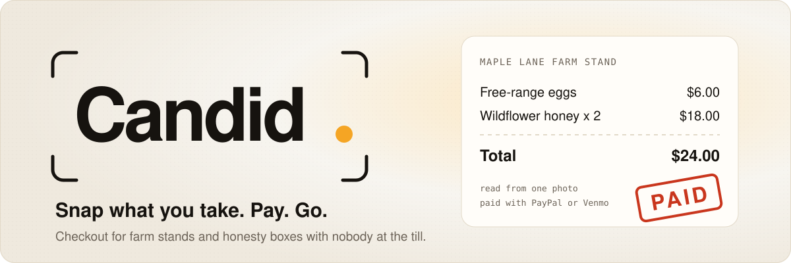

<a id="top"></a>

<p align="center">
  
</p>

<p align="center">
  <a href="https://candid-199683411709.us-central1.run.app"></a>
  &nbsp;
  <a href="https://candid-199683411709.us-central1.run.app/s/maple-lane"></a>
  &nbsp;
  <a href="https://candid-199683411709.us-central1.run.app/owner/demo-maple-lane"></a>
</p>

<p align="center">
  <sub>
    Built for the <b>PayPal AI Hackathon 2026</b>
    &nbsp;·&nbsp; PayPal JS SDK v6 &nbsp;·&nbsp; Orders v2 &nbsp;·&nbsp; Venmo &nbsp;·&nbsp; Payouts &nbsp;·&nbsp; Catalog Products &nbsp;·&nbsp; Webhooks
    &nbsp;·&nbsp; Gemini on Vertex AI &nbsp;·&nbsp; Google Cloud Run
  </sub>
</p>

<p align="center"><sub>Sandbox only. No real money moves. The demo stand and its growers are fictional.</sub></p>

<br />

<table>
  <tr>
    <td width="33%" valign="top">
      <b>For the customer</b><br />
      Scan the stand's QR code, take one photo of what's in your hands, check the list, pay with PayPal or Venmo. No app to install and no maths to do.
    </td>
    <td width="33%" valign="top">
      <b>For the owner</b><br />
      Count the shelf in the morning and at closing, by photo or by hand. Candid lines that up against every captured payment and shows exactly what left unpaid.
    </td>
    <td width="33%" valign="top">
      <b>For the growers</b><br />
      When several farms share one stand, each sale is already split by whose item it was. One tap sends everyone their share through PayPal Payouts.
    </td>
  </tr>
</table>

<br />

## Contents

<table>
  <tr>
    <td valign="top" width="33%">
      <b>The product</b><br />
      <a href="#overview">Candid in one minute</a><br />
      <a href="#problem">The problem</a><br />
      <a href="#how">How it works</a><br />
      <a href="#walkthrough">Try it in five minutes</a>
    </td>
    <td valign="top" width="33%">
      <b>How it's built</b><br />
      <a href="#architecture">Architecture</a><br />
      <a href="#sale">A sale, step by step</a><br />
      <a href="#paypal">PayPal integration</a><br />
      <a href="#gemini">Gemini, kept on a short leash</a><br />
      <a href="#reconcile">Shelf reconciliation</a><br />
      <a href="#payouts">Grower payouts</a><br />
      <a href="#safety">Trust and safety</a>
    </td>
    <td valign="top" width="33%">
      <b>Working on it</b><br />
      <a href="#design">Design and experience</a><br />
      <a href="#a11y">Accessibility</a><br />
      <a href="#structure">Project structure</a><br />
      <a href="#api">API reference</a><br />
      <a href="#local">Run it locally</a><br />
      <a href="#deploy">Deploy on Cloud Run</a><br />
      <a href="#quality">Tests and quality</a><br />
      <a href="#limits">Limits and what's next</a><br />
      <a href="#stack">Built with</a>
    </td>
  </tr>
</table>

<br />

<a id="overview"></a>

##  &nbsp;Candid in one minute

Roadside farm stands and honesty boxes run on trust: a table of eggs, honey and flowers, a hand-written price sign and a tin for cash. Nobody is there to take payment, so nobody is there to add things up, make change, or notice what walked off.

Candid is the till those stands never had. It needs nothing but a printed QR sign.

1. **The customer snaps their basket.** Gemini reads the photo against that stand's own price list and proposes a list of items.
2. **They check it and pay.** The server prices the cart from the catalog, never from the phone. PayPal or Venmo takes the payment.
3. **The owner counts the shelf twice a day.** A photo or a quick tally at opening and at closing. Candid compares what left the shelf with what was paid for.
4. **Growers get paid.** When several farms share a stand, takings are split by whose item sold and sent in one PayPal Payouts batch.

The AI only ever *proposes*. A person confirms every list before any money moves, and if the photo can't be read, the same screen works by hand.

<sub><a href="#top">Back to top</a></sub>

<a id="problem"></a>

##  &nbsp;The problem

Honesty stands are everywhere: in 2022, 116,617 US farms sold directly to consumers (USDA Census of Agriculture), and the same unattended tables line country roads from the UK to New Zealand and Japan. The way they take money hasn't changed in decades.

| What goes wrong today | Why it matters | What Candid does |
| --- | --- | --- |
| The cash tin gets emptied or stolen | One theft can wipe out a week of sales | Money goes straight to PayPal. There's no cash to steal. |
| Customers don't carry cash | Every "I'll come back later" is a lost sale | PayPal, Venmo, and cards through PayPal. |
| The customer has to do the maths | Mistakes and awkward rounding, usually in the stand's disfavour | One photo becomes an itemised, priced list. |
| A QR sticker for a payment handle | Takes the money, but the owner learns nothing about what sold | Every payment is tied to items, so sales show up per product. |
| The owner never knows what went missing | Shrinkage is a guess, so prices and stock are guesses too | Opening and closing counts against captured sales, item by item. |
| Several growers share one table | Splitting the tin by hand at night causes friction | Payouts per grower, worked out from what actually sold. |

<sub><a href="#top">Back to top</a></sub>

<a id="how"></a>

##  &nbsp;How it works

Candid has three screens, one for each person at the stand.

```
   SET UP (once)                  SELL (all day)                     CLOSE (each evening)
  ┌──────────────────────┐       ┌──────────────────────────┐       ┌──────────────────────────┐
  │ photograph the price │       │ customer scans the QR    │       │ owner photographs the    │
  │ sign                 │       │ sign and photographs     │       │ shelf again              │
  │                      │       │ their basket             │       │                          │
  │ Gemini drafts the    │──────▶│                          │──────▶│ Candid shows left,       │
  │ catalog; owner edits │       │ checks the list, pays    │       │ paid and taken unpaid    │
  │                      │       │ with PayPal or Venmo     │       │ for every item           │
  │ print the QR sign    │       │                          │       │                          │
  │                      │       │ receipt on the phone     │       │ one tap pays growers     │
  └──────────────────────┘       └──────────────────────────┘       └──────────────────────────┘
   /owner/new                     /s/<stand>                          /owner/<stand id>
```

**Setting up a stand** (`/owner/new`). The owner photographs their existing price sign. Gemini reads the items, prices and units off it into a draft catalog, which the owner corrects and confirms. Candid registers every item with the PayPal Catalog Products API and prints a QR sign that points at the stand's public page.

**Selling** (`/s/<stand>`). The customer opens the page from the QR code. No app and no account with Candid are needed. They photograph what they're taking and get an editable list with quantities. Anything Gemini wasn't sure about is marked so they look twice. When the list is right they pay with the PayPal or Venmo button. The receipt appears on the same screen.

**Closing** (`/owner/<stand id>`). The owner records an opening count in the morning and a closing count at the end of the day, either by photo or by typing numbers. The dashboard shows today's takings, every payment in a sortable grid, the reconciliation table, and each grower's share, ready to pay out.

<sub><a href="#top">Back to top</a></sub>

<a id="walkthrough"></a>

##  &nbsp;Try it in five minutes

The live demo runs on the PayPal **sandbox**, so nothing you do there costs anything. The demo stand, **Maple Lane Farm Stand**, sells four things:

| Item | Price | Grown by |
| --- | --- | --- |
| Free-range eggs | $6.00 a dozen | Rosa |
| Wildflower honey | $9.00 a jar | Tom |
| Sunflower bunch | $5.00 a bunch | Ana |
| Heirloom tomatoes | $4.00 a basket | Ana |

**Step 1. Look around.** Open the [landing page](https://candid-199683411709.us-central1.run.app). Scroll through the 3D stand: the cash box flies away, a phone scans the QR sign, the shelf is counted and growers are paid. The [demo hub](https://candid-199683411709.us-central1.run.app/app) links to every screen.

**Step 2. Be a customer.** Open [`/s/maple-lane`](https://candid-199683411709.us-central1.run.app/s/maple-lane), ideally on a phone.
- Tap **Take a photo of your basket** and photograph some eggs or a jar (a picture of them on another screen works too), or add items with the plus buttons.
- Check the list and change any quantity.
- Tap **PayPal** or **Venmo**. In the PayPal window, sign in with the **sandbox personal (buyer) account** given in the Devpost testing instructions. Don't use a real PayPal login, and don't use the seller account.
- Approve, and the receipt shows **Paid** with the PayPal capture id.

**Step 3. Be the owner.** Open [`/owner/demo-maple-lane`](https://candid-199683411709.us-central1.run.app/owner/demo-maple-lane).
- Your payment is already in **Today's payments**. The page refreshes itself every ten seconds.
- Under **Shelf check**, save an opening count, then a closing count with fewer items than were paid for. The reconciliation table shows what left the shelf unpaid and what that cost.
- Under **Pay the growers**, each grower's share of today's captured sales is shown. **Send payouts** creates one PayPal Payouts batch.

**Step 4. Set up your own stand (optional).** Open [`/owner/new`](https://candid-199683411709.us-central1.run.app/owner/new), photograph any price list, edit the draft and create the stand. Then open its **QR sign** page and print it.

<sub><a href="#top">Back to top</a></sub>

<a id="architecture"></a>

##  &nbsp;Architecture

One Next.js app serves the pages and the API. Everything that touches money or AI runs on the server, behind route handlers. The browser holds nothing secret.

```
   CUSTOMER  (any phone, no app)                    OWNER  (phone or laptop)
   /s/maple-lane                                    /owner/demo-maple-lane
   photo, check the list, pay                       shelf counts, sales, payouts
          │                                                  │
          │  basket photo, cart, approval                    │  shelf photo, counts, payout
          ▼                                                  ▼
  ┌────────────────────────────────────────────────────────────────────────────────┐
  │  CANDID SERVER      Next.js 15 route handlers on Google Cloud Run              │
  │                                                                                │
  │   pricing.ts      every total is priced here, from the stand's own catalog     │
  │   sales.ts        create the order, capture it once, apply verified webhooks   │
  │   ai.ts           photo in, JSON out, checked by Zod and against the catalog   │
  │   reconcile.ts    opening shelf, closing shelf, captured sales in between      │
  │   store.ts        Firestore, one write at a time per stand                     │
  │   env.ts          refuses to talk to anything but the PayPal sandbox           │
  └────────────┬─────────────────────────┬─────────────────────────┬───────────────┘
               │                         │                         │
               ▼                         ▼                         ▼
  ┌────────────────────────┐  ┌────────────────────────┐  ┌────────────────────────┐
  │  PAYPAL  (sandbox)     │  │  GEMINI 3.8 FLASH      │  │  GOOGLE CLOUD          │
  │                        │  │                        │  │                        │
  │  JS SDK v6 buttons     │  │  on Vertex AI          │  │  Firestore records     │
  │  Orders v2             │  │  structured JSON out   │  │  Secret Manager        │
  │  Catalog Products      │  │  keyless, through the  │  │  Cloud Run service     │
  │  Payouts               │  │  service account       │  │  account, no API keys  │
  │  Webhooks              │  │                        │  │                        │
  └────────────┬───────────┘  └────────────────────────┘  └────────────────────────┘
               │
               └──▶  POST /api/webhooks/paypal      nothing applied until PayPal verifies the signature
```

A few decisions shape the whole codebase:

- **Money is integers.** Every amount is whole cents, from the catalog to the capture. Decimal strings exist only at the PayPal boundary, and `money.ts` converts them exactly in both directions.
- **The server is the only cashier.** The browser sends item ids and quantities. Prices, totals and the PayPal order are all produced on the server.
- **AI output is input, not truth.** Gemini's JSON is validated against a schema, re-checked against the stand's real item ids, clamped to sane counts, and then shown to a person.
- **Stand data is a single record per stand.** Sales, shelf counts and payouts live together in one document, and writes to a stand are serialised, so a capture and a payout can never race.
- **No keys anywhere.** Gemini and Firestore authenticate as the Cloud Run service identity. The only secret, the PayPal sandbox client secret, lives in Secret Manager.

<sub><a href="#top">Back to top</a></sub>

<a id="sale"></a>

##  &nbsp;A sale, step by step

```
      CUSTOMER                  CANDID SERVER                  GEMINI                    PAYPAL
          │                           │                           │                         │
    1     │── basket photo ──────────▶│                           │                         │
    2     │                           │── photo + catalog ───────▶│                         │
    3     │                           │◀── items, qty, sure? ─────│                         │
    4     │◀── list to check ─────────│                           │                         │
    5     │── confirmed cart ────────▶│  prices it from catalog   │                         │
    6     │                           │── create order ────────────────────────────────────▶│
    7     │◀══ approve in the PayPal or Venmo window ══════════════════════════════════════▶│
    8     │── approved ──────────────▶│── order status? ───────────────────────────────────▶│
    9     │                           │── capture, same request id ────────────────────────▶│
   10     │◀── receipt: Paid ─────────│◀── COMPLETED, exactly $24.00 ───────────────────────│
   11     │                           │◀── webhook, signature verified ─────────────────────│
          │                           │                           │                         │
```

1. **Photo.** The phone shrinks the photo to 1280 px and re-encodes it as JPEG in a canvas, which also drops EXIF data such as GPS location. Photos are never stored.
2. **Read.** `ai.ts` sends the image to Gemini with the stand's catalog, including a short "what it looks like" note per item, and asks for JSON that matches a schema.
3. **Check.** The answer is parsed with Zod. Unknown item ids are dropped, duplicates merged and counts clamped. If anything fails, the customer simply adds items by hand.
4. **Confirm.** Items Gemini was unsure of are flagged. The customer edits quantities. Nothing has been charged yet.
5. **Price.** `pricing.ts` prices the cart from the stand's catalog. Any item id the stand doesn't sell, or a quantity that isn't a positive whole number, is refused.
6. **Order.** `paypal.ts` creates an Orders v2 order through the PayPal Server SDK, with one line per item, the stand as the brand name, `PAY_NOW` and no shipping, plus return and cancel addresses for the redirect flow.
7. **Approve.** The customer approves in the PayPal or Venmo window opened by the JS SDK v6 one-time payment session. That approval happens entirely on PayPal.
8. **Status first.** Before capturing, the server asks PayPal for the order's status and captures only an order that is `APPROVED` (or already `COMPLETED`). A closed popup never turns into a failed sale.
9. **Capture once.** Every sale has one stable `PayPal-Request-Id`. A retry, a double tap or a lost reply returns the same capture instead of charging twice.
10. **Receipt.** A sale is marked paid only when PayPal answers `COMPLETED` for exactly the priced amount. The receipt shows the PayPal capture id.
11. **Webhook.** `PAYMENT.CAPTURE.COMPLETED` arrives separately. It is applied only after PayPal's own verify-signature API accepts it, never downgrades a sale, and a different amount is flagged instead of trusted.

<sub><a href="#top">Back to top</a></sub>

<a id="paypal"></a>

##  &nbsp;PayPal integration

Every PayPal call is a real sandbox call. Nothing is mocked in the running app.

| PayPal product | What Candid uses it for | Where |
| --- | --- | --- |
| **JS SDK v6** | `paypal-payments` and `venmo-payments` components, `findEligibleMethods`, one-time payment sessions with `presentationMode: "auto"` | `src/components/PayPalCheckout.tsx` |
| **Venmo** | A second button on the same session. The sandbox is told the buyer is in the US, so Venmo is offered during judging from anywhere. | `src/components/PayPalCheckout.tsx` |
| **Orders v2** via the **PayPal Server SDK** (generated by APIMatic) | `createOrder`, `getOrder`, `captureOrder` with a stable request id and `return=representation` | `src/lib/paypal.ts` |
| **Catalog Products API** | Every item of a new stand is registered as a PayPal product | `src/app/api/stands/route.ts` |
| **Payouts API** | One batch per payout run, one line per grower, with a unique sender batch id | `src/lib/paypal.ts`, `src/app/api/stands/[id]/payouts/route.ts` |
| **Webhooks** | `PAYMENT.CAPTURE.COMPLETED` confirmation, verified with `/v1/notifications/verify-webhook-signature` | `src/app/api/webhooks/paypal/route.ts` |

The checkout handles all three ways a PayPal window can end:

```
  approve ─────────────▶  onApprove  ──▶  capture  ──▶  Paid
  close the window ────▶  onCancel   ──▶  status check: not approved  ──▶  "Payment cancelled", cart kept
  approved, window stuck ▶ onCancel  ──▶  status check: APPROVED      ──▶  capture  ──▶  Paid
  full-page redirect ──▶  back to /s/<stand>?paypal=return  ──▶  capture  ──▶  Paid
```

<sub><a href="#top">Back to top</a></sub>

<a id="gemini"></a>

##  &nbsp;Gemini, kept on a short leash

Candid uses Gemini 3.8 Flash on Vertex AI for three jobs. Each one asks for structured JSON with a JSON schema, low thinking and temperature 0, so answers are fast and repeatable.

| Job | Input | Output | Who checks it |
| --- | --- | --- | --- |
| Read a price sign | Photo of a hand-written or printed sign | Draft items with name, price, unit | The owner, before the stand is created |
| Read a basket | Photo plus the stand's catalog | Item ids, quantities, and a confidence flag per line | The customer, before paying |
| Count a shelf | Photo plus the stand's catalog | Item ids and counts | The owner, before saving the count |

The guard rails, all in `src/lib/ai.ts`:

- The model only ever sees one stand's catalog, so it picks from a closed list instead of inventing products.
- Every reply goes through `safeParse`. A malformed reply, a failed call or a missing configuration becomes one plain error, and the screen falls back to manual entry.
- `sanitiseCounts` drops ids the stand doesn't sell, merges duplicate lines, and clamps every count to between 0 and 500.
- Photo routes are rate-limited per visitor (30 basket photos, 20 shelf photos and 10 signs per ten minutes) so the public demo can't run up model costs.
- Gemini never sets a price and never triggers a payment.

On the live demo, a basket photo with one egg carton and two jars of honey comes back as exactly that, in about four to six seconds.

<sub><a href="#top">Back to top</a></sub>

<a id="reconcile"></a>

##  &nbsp;Shelf reconciliation

The question every honesty-stand owner wants answered is simple: *what was taken without being paid for?* Candid answers it per item, from two counts and the payments between them.

```
   MORNING                          DURING THE DAY                      EVENING
  ┌─────────────────────┐          ┌──────────────────────────┐        ┌─────────────────────┐
  │ opening count       │          │ customers pay            │        │ closing count       │
  │ photo or typed      │ ───────▶ │ each sale captured by    │ ─────▶ │ photo or typed      │
  │ eggs 12, honey 8    │          │ PayPal, with its items   │        │ eggs 7, honey 6     │
  └─────────────────────┘          └──────────────────────────┘        └──────────┬──────────┘
                                                                                  │
                                                                                  ▼
                                          left the shelf  =  opening  -  closing
                                          taken unpaid    =  left the shelf  -  paid for
```

A worked example for one day at the demo stand:

| Item | Opening | Closing | Left the shelf | Paid for | Taken unpaid | Cost |
| --- | ---: | ---: | ---: | ---: | ---: | ---: |
| Free-range eggs | 12 | 7 | 5 | 4 | **1** | $6.00 |
| Wildflower honey | 8 | 6 | 2 | 2 | 0 | $0.00 |
| Sunflower bunch | 10 | 10 | 0 | 0 | 0 | $0.00 |
| **Total** | | | **7** | **6** | **1** | **$6.00** |

The dashboard reports this as a **paid rate of 86%**, *6 of 7 items paid for*, and **$6.00 left unpaid**. The rules in `src/lib/reconcile.ts` are deliberately conservative:

- Only sales **captured** between the two counts are counted. Pending or failed orders never hide a loss.
- Losses are never negative. Restocking during the day or a customer paying for something they then left behind doesn't create a fake surplus.
- If nothing left the shelf, the paid rate is left blank rather than shown as a misleading 0% or 100%.

<sub><a href="#top">Back to top</a></sub>

<a id="payouts"></a>

##  &nbsp;Grower payouts

Many stands are shared: one farm sells eggs, a neighbour brings honey. Each item in a stand's catalog belongs to a grower, so each captured sale already knows who earned what.

```
                       captured sales not yet paid out: $49.00
                                         │
              ┌──────────────────────────┼──────────────────────────┐
              ▼                          ▼                          ▼
         Rosa (eggs)                Tom (honey)          Ana (sunflowers, tomatoes)
          3 x $6.00                  2 x $9.00             1 x $5.00 + 2 x $4.00
            $18.00                     $18.00                      $13.00
              │                          │                          │
              └──────────────────────────┼──────────────────────────┘
                                         ▼
                         one PayPal Payouts batch, one line each
```

`growerShares` in `src/lib/reconcile.ts` skips every sale already included in an earlier batch, so pressing **Send payouts** twice never pays anyone twice. The batch, its PayPal batch id and the sales it covered are saved with the stand.

<sub><a href="#top">Back to top</a></sub>

<a id="safety"></a>

##  &nbsp;Trust and safety

A payments app for unattended stands has to be harder to fool than a cash tin. These are the rules the code enforces, with where to find them.

| Rule | How | Where |
| --- | --- | --- |
| Sandbox only | The PayPal API base is fixed to the sandbox host, and the server refuses to start a payment if any PayPal setting mentions a live host | `src/lib/env.ts` |
| Prices come from the server | Carts carry item ids and quantities only. Unknown items and bad quantities are refused | `src/lib/pricing.ts` |
| Paid means PayPal said so | A sale becomes paid only on `COMPLETED` for exactly the priced amount | `src/lib/paypal.ts`, `src/lib/sales.ts` |
| No double charges | One stable `PayPal-Request-Id` per sale, so retries return the same capture | `src/lib/sales.ts` |
| No capture without approval | The order status is checked before every capture | `src/lib/sales.ts` |
| Webhooks are verified | PayPal's verify-signature API must accept the event. Only PayPal certificate URLs are allowed. Duplicates are no-ops | `src/app/api/webhooks/paypal/route.ts` |
| Owner pages are private | Each stand has a random owner key, stored only as a hash. The browser keeps it in an httpOnly cookie, compared in constant time. The demo stand is left open for judging | `src/lib/http.ts` |
| Requests come from Candid | Every state-changing route checks the request's origin | `src/lib/http.ts` |
| Customers see only what they need | The public stand view strips the owner key hash and growers' PayPal emails | `src/lib/public.ts` |
| Photos stay private | Resized and stripped of EXIF on the phone, sent to Gemini, never stored | `src/lib/client.ts` |
| Errors don't leak | API errors are short, plain sentences. Internals go to the server log only | `src/lib/http.ts` |
| Safe headers | `nosniff`, a strict referrer policy, same-origin framing, and camera access only for Candid itself | `next.config.ts` |

<sub><a href="#top">Back to top</a></sub>

<a id="design"></a>

##  &nbsp;Design and experience

Candid has two moods. The landing page is a night-time scene that tells the story. The working app is warm, light porcelain, built for a phone in bright daylight.

**The landing page** is a scroll-driven 3D story built with Three.js and React Three Fiber.
- A farm stand modelled entirely from primitives: no downloaded models and no textures to load.
- Six chapters: trust, the cash box, snap, pay, count, payout. Scrolling moves the camera between framings while GSAP ScrollTrigger and Lenis keep the motion smooth.
- The phone in the scene is live. Its screen is drawn on a canvas, so it really shows the QR scan and then the payment going through.
- A short Remotion explainer plays the whole loop in twelve seconds, and a sideways-scrolling strip shows where else Candid fits: campus pantries, office snack shelves, bake sales and co-op stands.

**Small things that make it feel finished:**
- A viewfinder preloader. Brackets frame the wordmark while fonts and the 3D scene load, then a shutter opens. It waits for real readiness, not a fixed timer, and has hard limits so it can never get stuck.
- A camera-viewfinder cursor that locks onto buttons and links and flashes on click. It only appears with a mouse or trackpad, and never with reduced motion.
- Magnetic buttons and tilting cards, with no icon fonts and no emoji: every icon is a hand-drawn inline SVG.
- Type set in Atkinson Hyperlegible for reading, Schibsted Grotesk for display and JetBrains Mono for figures.
- Every inner page has a back link and the same header, so nobody gets lost between the customer and owner views.

**The owner dashboard** uses AG Grid for the payments table (sortable, keyboard-friendly), stat tiles for today's numbers, and a reconciliation table that reads as plain sentences.

<sub><a href="#top">Back to top</a></sub>

<a id="a11y"></a>

##  &nbsp;Accessibility

Built to WCAG 2.2 AA, because a farm stand's customers are everyone.

- **Keyboard.** Every action works without a mouse. Focus is always visible, a skip link jumps past the header, and the receipt takes focus when a payment completes.
- **Screen readers.** Every control has a name. Status changes (reading the photo, paying, paid, cancelled) are announced through live regions. Decorative SVGs are hidden from assistive technology.
- **Never colour alone.** Status is always text plus an icon, and amounts are written out.
- **Motion.** With `prefers-reduced-motion`, the 3D scene and text reveals stop animating, smooth scrolling is turned off, the custom cursor is not used and the explainer gets play controls instead of autoplay.
- **Reading.** Body text uses Atkinson Hyperlegible, designed by the Braille Institute for low-vision readers. Main buttons and quantity steppers are at least 44 px.
- **Disabled means disabled.** While a payment is in progress the PayPal buttons are made `inert`, so they can't be tapped or reached with the keyboard twice.

<sub><a href="#top">Back to top</a></sub>

<a id="structure"></a>

##  &nbsp;Project structure

```
candid/
├── src/
│   ├── app/                          pages and API routes (Next.js App Router)
│   │   ├── page.tsx                  landing page: the 3D scroll story
│   │   ├── app/page.tsx              demo hub: every screen, what to look for
│   │   ├── s/[slug]/page.tsx         customer checkout for one stand
│   │   ├── owner/new/page.tsx        set up a stand from a price-sign photo
│   │   ├── owner/[id]/page.tsx       owner dashboard
│   │   ├── owner/[id]/sign/page.tsx  printable QR sign
│   │   └── api/                      route handlers, listed in the API reference below
│   │
│   ├── lib/                          server logic, no UI
│   │   ├── money.ts                  integer cents, exact decimal conversion
│   │   ├── pricing.ts                prices a cart from the catalog
│   │   ├── paypal.ts                 Server SDK orders, REST for catalog, payouts, webhooks
│   │   ├── sales.ts                  capture rules and webhook application
│   │   ├── reconcile.ts              shelf reconciliation and grower shares
│   │   ├── ai.ts                     Gemini prompts, schemas and clean-up
│   │   ├── store.ts                  Firestore, Redis or local files, one writer per stand
│   │   ├── env.ts                    sandbox guard and configuration
│   │   ├── http.ts                   errors, owner auth, origin checks
│   │   └── types.ts                  domain types and request schemas
│   │
│   ├── components/
│   │   ├── StandCheckout.tsx         photo, list, pay, receipt
│   │   ├── PayPalCheckout.tsx        JS SDK v6 PayPal and Venmo buttons
│   │   ├── OwnerDashboard.tsx        takings, shelf checks, payouts
│   │   ├── SalesGrid.tsx             AG Grid payments table
│   │   ├── story/                    landing page: scenes, chapters, preloader
│   │   ├── three/                    3D models and the live phone screen
│   │   └── fx/                       cursor, magnetic buttons, tilt cards
│   │
│   └── remotion/SaleExplainer.tsx    the twelve-second explainer
│
├── tests/                            Vitest unit tests
├── docs/spec.md                      product spec
├── Dockerfile                        standalone Next.js image for Cloud Run
└── .env.example                      every setting, documented
```

<sub><a href="#top">Back to top</a></sub>

<a id="api"></a>

##  &nbsp;API reference

All routes are under `/api`. Request bodies are JSON and validated with Zod. Every state-changing route checks the request's origin.

| Method | Route | What it does | Access |
| --- | --- | --- | --- |
| `GET` | `/paypal/client-id` | The public sandbox client id for the JS SDK | Anyone |
| `POST` | `/ai/sign` | Reads a price-sign photo into draft items | Anyone, 10 per 10 min |
| `POST` | `/stands` | Creates a stand, sets the owner cookie, registers Catalog products | Anyone |
| `POST` | `/stands/:id/basket` | Reads a basket photo against the stand's catalog | Anyone, 30 per 10 min |
| `POST` | `/stands/:id/orders` | Prices the cart and creates the PayPal order | Anyone |
| `POST` | `/orders/:orderId/capture` | Checks status, then captures once. `409` if the buyer didn't approve | Anyone |
| `POST` | `/stands/:id/shelf-photo` | Counts a shelf photo | Owner, 20 per 10 min |
| `POST` | `/stands/:id/shelf` | Saves an opening or closing count | Owner |
| `GET` | `/stands/:id/summary` | Today's takings, sales, reconciliation and grower shares | Owner |
| `POST` | `/stands/:id/payouts` | Sends one Payouts batch for unpaid grower shares | Owner |
| `POST` | `/webhooks/paypal` | Applies verified PayPal capture events | PayPal, signature verified |

<sub><a href="#top">Back to top</a></sub>

<a id="local"></a>

##  &nbsp;Run it locally

You need Node 20 or newer, a PayPal developer account (free), and optionally a Google Cloud project with Vertex AI.

**1. Install**

```bash
git clone <this repository>
cd candid
npm install
cp .env.example .env.local
```

**2. Get PayPal sandbox credentials.** At [developer.paypal.com](https://developer.paypal.com), open *Apps & Credentials*, stay on **Sandbox**, create an app, and turn on **Payouts**. Copy the client id and secret into `.env.local`. Under *Sandbox accounts* you'll find a personal (buyer) account to pay with.

**3. Connect Gemini, without a key.** In a Google Cloud project with the Vertex AI API enabled:

```bash
gcloud auth application-default login
```

Then set `GOOGLE_GENAI_USE_VERTEXAI=true` and `GOOGLE_CLOUD_PROJECT` in `.env.local`. A `GEMINI_API_KEY` works instead if you prefer. Without either, Candid still runs and every photo step falls back to entering items by hand.

**4. Start**

```bash
npm run dev
```

Open http://localhost:3000. Locally, data is kept in `./.data`. Delete that folder to reset the demo stand.

<a id="config"></a>

###  &nbsp;Configuration

| Variable | Required | What it's for |
| --- | --- | --- |
| `PAYPAL_ENV` | Yes | Must be `sandbox`. Anything else stops payments. |
| `PAYPAL_CLIENT_ID`, `PAYPAL_CLIENT_SECRET` | Yes | Sandbox app credentials |
| `PAYPAL_WEBHOOK_ID` | No | Sandbox webhook pointed at `/api/webhooks/paypal`. Without it, webhooks are ignored and capture still works. |
| `SITE_URL` | No | Public address printed on QR signs. Defaults to the address the page was opened on. |
| `GOOGLE_GENAI_USE_VERTEXAI`, `GOOGLE_CLOUD_PROJECT` | No | Gemini on Vertex AI, authenticated without keys |
| `GOOGLE_CLOUD_LOCATION` | No | Vertex AI location, default `global` |
| `GEMINI_MODEL` | No | Default `gemini-3.8-flash` |
| `GEMINI_API_KEY` | No | Alternative to Vertex AI |
| `STORE_BACKEND` | No | `firestore` to use Firestore. Otherwise Upstash Redis if configured, else local files. |
| `UPSTASH_REDIS_REST_URL`, `UPSTASH_REDIS_REST_TOKEN` | No | Optional Redis storage |
| `DEMO_GROWER_1_EMAIL`, `DEMO_GROWER_2_EMAIL`, `DEMO_GROWER_3_EMAIL` | No | Sandbox personal accounts that receive the demo stand's payouts |

<sub><a href="#top">Back to top</a></sub>

<a id="deploy"></a>

##  &nbsp;Deploy on Cloud Run

The live demo runs on Google Cloud Run with its own service account, `candid-run`, which holds only three permissions:

```
   candid-run  (Cloud Run service identity)
        │
        ├──▶  roles/aiplatform.user                Gemini on Vertex AI
        ├──▶  roles/datastore.user                 Firestore stand records
        └──▶  secretAccessor on one secret         the PayPal sandbox client secret
```

```bash
gcloud run deploy candid --source . --region us-central1 \
  --service-account candid-run@PROJECT_ID.iam.gserviceaccount.com \
  --allow-unauthenticated --min-instances 1 --max-instances 1 \
  --set-env-vars PAYPAL_ENV=sandbox,PAYPAL_CLIENT_ID=...,SITE_URL=https://...,GOOGLE_GENAI_USE_VERTEXAI=true,GOOGLE_CLOUD_PROJECT=PROJECT_ID,GOOGLE_CLOUD_LOCATION=global,STORE_BACKEND=firestore,PAYPAL_WEBHOOK_ID=... \
  --set-secrets PAYPAL_CLIENT_SECRET=candid-paypal-client-secret:latest
```

The `Dockerfile` builds Next.js in standalone mode on Node 22 and runs it as a non-root user on port 8080. `--max-instances 1` is deliberate for the demo: writes to a stand are serialised inside the process, and one warm instance keeps every judge's first tap fast.

<sub><a href="#top">Back to top</a></sub>

<a id="quality"></a>

##  &nbsp;Tests and quality

```bash
npm test            # 26 unit tests (Vitest)
npm run typecheck   # TypeScript, strict
npm run lint        # ESLint
npm run build       # production build
```

The tests cover the rules that protect money, not the framework:

| Area | What is proven |
| --- | --- |
| Money and pricing | Cents and PayPal decimals round-trip exactly. Prices come from the catalog, never the client. Duplicate lines merge. Unknown items and bad quantities are refused. |
| Capture | A sale is paid only after PayPal confirms. PayPal is never called twice for a captured sale. Retries reuse the request id. A cancelled popup is neither captured nor flagged. A capture whose reply was lost is recovered. |
| Webhooks | Matching captures are confirmed. A second delivery changes nothing. A different amount is flagged, not trusted. |
| Reconciliation | Unpaid items are found. Uncaptured and out-of-hours sales are ignored. Losses are never negative. An empty day has no paid rate. |
| Payouts and AI clean-up | Shares are split by grower and never include a sale twice. Unknown ids are dropped, duplicates merged and counts clamped. |
| Sandbox guard | Only the sandbox host is ever used. Live mode, or any live host in any setting, is refused. |

Beyond the unit tests, the full loop was run against the real PayPal sandbox and Vertex AI: order creation, approval, capture, a repeated capture returning the same capture id, basket and shelf photos read correctly, and Firestore reads and writes on the deployed service.

<sub><a href="#top">Back to top</a></sub>

<a id="limits"></a>

##  &nbsp;Limits and what's next

Being honest about what a hackathon build doesn't do yet:

- **One server instance.** Writes are serialised in-process, which is why the demo runs exactly one instance. Firestore transactions would lift that limit.
- **Photo counting has limits.** Gemini counts a tidy shelf well. Deep stacks and items hidden behind others are where it struggles, which is why every count is editable before it's saved.
- **Refunds.** The webhook is subscribed to refunds and denials, but only completed captures change a sale today. Refund handling on the dashboard is next.
- **Sandbox only, by design.** Going live would need PayPal onboarding for each stand owner, so their money goes straight to their own account.

What we'd build next:

1. **PayPal onboarding for stand owners**, so each stand is paid directly as its own merchant.
2. **Restock alerts**, using the closing count to tell an owner what to bring tomorrow.
3. **A weekly owner report** with the paid rate trend, best sellers and when unpaid items tend to disappear.
4. **A shared-stand view for growers**, where each grower sees only their own items, sales and payouts.

<sub><a href="#top">Back to top</a></sub>

<a id="stack"></a>

##  &nbsp;Built with

| Layer | Tools |
| --- | --- |
| Payments | PayPal JS SDK v6 (PayPal and Venmo), PayPal Server SDK (APIMatic), Orders v2, Catalog Products, Payouts, Webhooks |
| AI | Google Gemini 3.8 Flash on Vertex AI, `@google/genai`, Zod schemas |
| App | Next.js 15 (App Router), React 19, TypeScript |
| Cloud | Google Cloud Run, Firestore, Secret Manager, Cloud Build, Artifact Registry |
| 3D and motion | Three.js, React Three Fiber, drei, GSAP with ScrollTrigger and SplitText, Lenis, Remotion |
| Data UI | AG Grid Community |
| Quality | Vitest, ESLint, TypeScript strict mode |

##  &nbsp;License

MIT. See [LICENSE](LICENSE).

<p align="center"><sub>Made by a two-person team for the PayPal AI Hackathon 2026. &nbsp;·&nbsp; <a href="#top">Back to top</a></sub></p>
